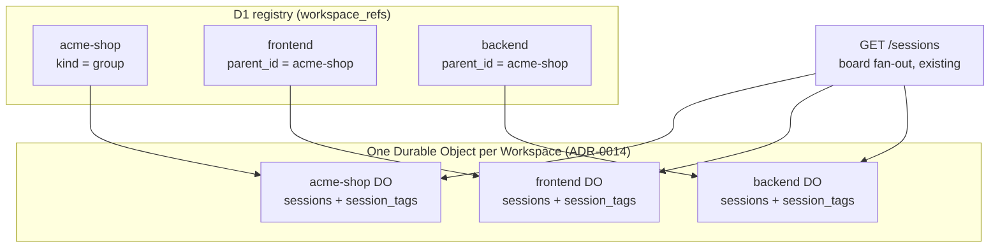
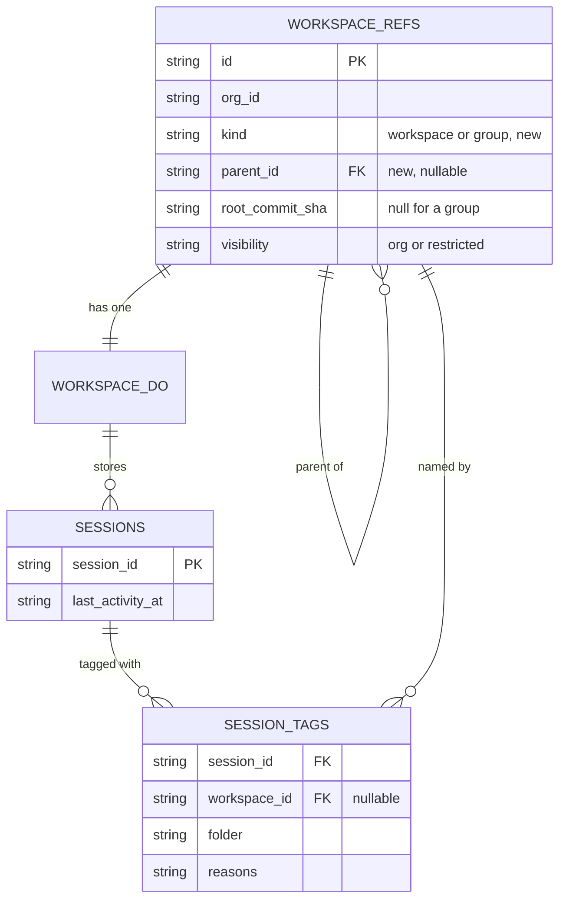
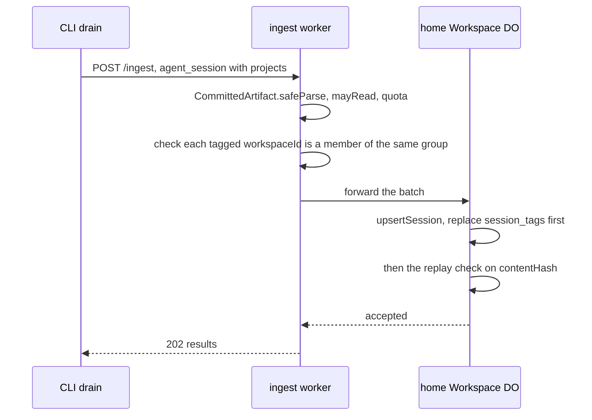
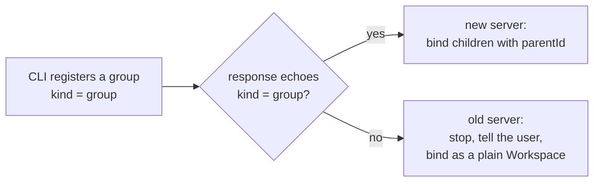
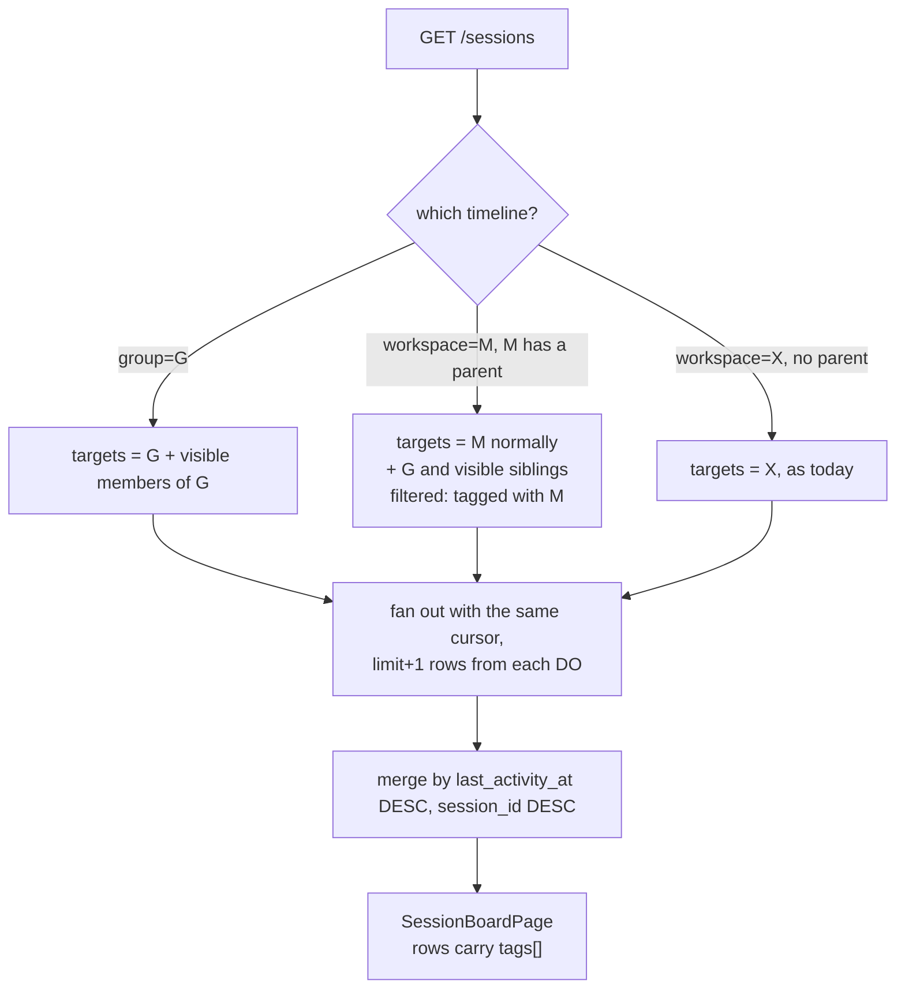
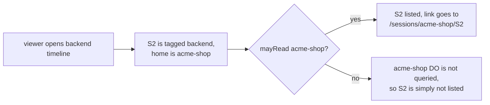
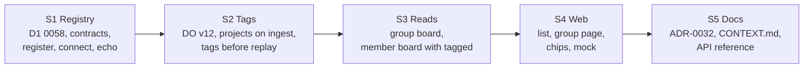

# Server changes for workspaces that contain Projects

| | |
|---|---|
| **Status** | Draft for review |
| **Date** | 2026-11-27 |
| **Companion to** | [workspace-projects-and-tagging.md](../workspace-projects-and-tagging.md) (the CLI TRD) |
| **Target repo** | the server monorepo (`apps/ingest`, `apps/web`, `packages/contracts`, `packages/db`) |
| **Needs there** | ADR-0032 (amends ADR-0014), `CONTEXT.md` glossary entries, Linear tickets (team ATL) |

> **The phased plan is [workspace-server-plan.md](workspace-server-plan.md).** It corrects this design in nine places (its §3): a feature flag, lenient `projects` parsing, `include=tagged` instead of changing `workspace=`, no tags on the socket, a capability on the list, promoting a Workspace to a group, the erase and archive lists, an Axis guard, and the deploy order.
>
> This doc lives in the CLI repo because the server repo was attached read-only. Paths below are relative to the server repo root; line numbers are from commit `cac142c0`.

---

## 1. Summary

The server already has everything the feature needs except two ideas: **a Workspace can be a group of Workspaces**, and **a session can be tagged with other Workspaces**. Both fit the existing architecture without a central session table.



| What | How, in one line |
|---|---|
| Group | `workspace_refs` gets `kind` (`workspace` or `group`) and `parent_id`. A group is a normal Workspace row with its own DO. |
| Tags | `agent_session` artifacts get an optional `projects[]`. Each DO stores them in a new `session_tags` table. |
| Group timeline | The existing board fan-out, over the group and its members |
| Member timeline | A fan-out over the member, plus the group and its siblings **filtered to sessions tagged with the member** |
| Access | Unchanged. A session is readable only through its home Workspace. Tags never grant access. |

---

## 2. What the investigation found

Five facts shape this design. Each conflicts with an assumption in the CLI TRD.

| # | Finding | Where | Consequence |
|---|---|---|---|
| F1 | The cloud entity is the **Workspace**. In `CONTEXT.md`, *Project* means a local folder and is "never the server-side aggregate". The web UI shows a Workspace as a "project". | `CONTEXT.md:12-24` | The cloud can't add "a Project of kind workspace". It needs a new glossary term (§3). |
| F2 | Sessions live in **one Durable Object per Workspace**, not in a shared table | `apps/ingest/src/workspace-do.ts:355-373`; ADR-0014 | The TRD's §7.8 SQL can't run. Timelines must use the board's fan-out. |
| F3 | The board already fans out to up to 50 Workspace DOs and merges them with a global cursor | `apps/ingest/src/reads.ts:57`, `196-319` | A group timeline is mostly "fan out over a list of Workspaces" |
| F4 | A session whose `contentHash` is unchanged is **dropped as a replay** | `workspace-do.ts:2159` | Tags must be applied **before** the replay check, or a re-send with new tags does nothing |
| F5 | Zod schemas **strip** unknown fields; there is no `.strict()` | `packages/contracts/src/artifacts.ts:158`, `workspaces.ts:89`, `sync-runs.ts:271` | Today's server silently drops `projects`, `kind` and `parentId`. The CLI needs a way to detect support (§6.3). |

Also relevant:

- **Access:** `reachable()` answers 404 for a Workspace the caller can't read, and org admins can't read sessions in restricted Workspaces (`apps/ingest/src/workspace-call.ts:43-68`).
- **Plan cap:** `workspaceCapRefusal` counts every `workspace_refs` row (`apps/ingest/src/limits.ts:181`).
- **Grouping precedent:** chat channels already carry Workspace tags that "never grant or withhold access" (`CONTEXT.md:122-124`, `apps/chat/src/chat-do.ts:294`).
- **Mirrors overlap:** Axis Mirrors already let one Workspace hold several repositories (`CONTEXT.md:452-455`). See §10.

---

## 3. Naming

The CLI, the web UI and the wire currently use three different vocabularies:

| Concept | CLI TRD (local) | Wire / glossary (server) | Web UI label |
|---|---|---|---|
| A folder of repositories, bound once | Workspace | **Group Workspace** (`kind: "group"`) *(new)* | **Workspace** |
| A child repository in it | Member Project | **Member Workspace** (`parentId` set) *(new)* | **Project** |
| A plain repository | Project | Workspace (`kind: "workspace"`) | Project |
| A session's link to another Workspace | Tag | **Session tag** *(new)* | chip |

New `CONTEXT.md` entries, to be recorded in ADR-0032:

- **Group Workspace:** a Workspace whose `kind` is `group`. It has no fingerprint. It holds the sessions started in the group's folder, and its member Workspaces hold the rest. One level only.
- **Member Workspace:** a Workspace whose `parent_id` names a Group Workspace in the same Organisation.
- **Session tag:** a link from a session to a Workspace whose files it changed (`edited`) or where it committed (`committed`). Like a channel's Workspace tag, it never grants or withholds access.

---

## 4. Data model

### 4.1 D1 registry: migration `0058_workspace_groups.sql`

`workspace_refs` is "extended in place, never replaced", and new columns must be nullable or defaulted (`packages/db/src/schema.ts:37-42`).

```sql
ALTER TABLE workspace_refs ADD COLUMN kind TEXT NOT NULL DEFAULT 'workspace';  -- 'workspace' | 'group'
ALTER TABLE workspace_refs ADD COLUMN parent_id TEXT;                          -- a group's id, or NULL
CREATE INDEX workspace_refs_parent ON workspace_refs (parent_id);
```

Rules, enforced in `register`, `connect` and `PATCH` rather than in SQL:

| Rule | Error code (additive) |
|---|---|
| `parent_id` must point to a row with `kind = 'group'` | `parent_not_group` |
| The parent is in the same Organisation | `parent_other_org` |
| A group can't have a parent (one level only) | `nested_group` |
| The parent isn't archived | `parent_archived` |
| A group has no `root_commit_sha` | ignored if sent |

### 4.2 Workspace DO: migration v12

Add the next entry to the append-only `MIGRATIONS` array (`workspace-do.ts:335-684`). `schema_version` goes from 11 to 12.

```sql
CREATE TABLE session_tags (
  session_id   TEXT NOT NULL,
  workspace_id TEXT,          -- the tagged Workspace; NULL while the folder is unbound
  folder       TEXT NOT NULL, -- relative to the group folder, e.g. "backend"
  reasons      TEXT NOT NULL, -- JSON array: ["edited","committed"]
  PRIMARY KEY (session_id, folder)
);
CREATE INDEX session_tags_by_workspace ON session_tags (workspace_id, session_id);
```



**Why there's no D1 tag index in v1:** tags only ever point inside one group, so a member's tagged sessions can only have their home in the group or a sibling. That is at most N+1 DOs, which the fan-out already handles. A D1 `session_tags` index becomes worth adding if tags later need to cross groups, or to count hidden sessions for a placeholder (§7).

---

## 5. Contracts (`packages/contracts`)

Every change is **additive and optional**, so the frozen desktop wire keeps working (`workspaces.ts:9-12`).

| Schema | File | Change |
|---|---|---|
| `AgentSessionArtifact` | `src/artifacts.ts:158` | `projects: z.array(SessionProjectTag).max(64).optional()` |
| `SessionProjectTag` *(new)* | `src/artifacts.ts` | `{ workspaceId: string \| null, folder: string, reasons: ("home" \| "edited" \| "committed")[] }` |
| `RegisterWorkspaceRequest` | `src/workspaces.ts:89` | `kind?: "workspace" \| "group"`, `parentId?: string` |
| `UpdateWorkspaceRequest` | `src/workspaces.ts:101` | `parentId?: string \| null` (null detaches) |
| `ConnectWorkspaceRequest` | `src/sync-runs.ts:271` | `kind?`, `parentId?` (§6.2) |
| `RegisteredWorkspace`, list items | `src/workspaces.ts:132` | **echo** `kind` and `parentId` (§6.3) |
| `SessionSummary` | `src/sessions.ts:106` | `tags?: SessionTag[]` (only `workspaceId`, `workspaceSlug`, `reasons`) |
| Error codes | `src/workspaces.ts:247-327` | the four codes in §4.1 |

The wire example in the CLI TRD §7.7 should read:

```json
{
  "type": "agent_session",
  "rowId": "…", "orgId": "…", "workspaceId": "ws_acme_shop", "sessionId": "…",
  "projects": [
    { "workspaceId": "ws_backend",  "folder": "backend",  "reasons": ["edited", "committed"] },
    { "workspaceId": "ws_frontend", "folder": "frontend", "reasons": ["edited"] },
    { "workspaceId": null,          "folder": "mobile",   "reasons": ["edited"] }
  ]
}
```

The home Workspace is the artifact's own `workspaceId`, so a `home` entry isn't needed on the wire. `projects` is the **complete set**: an empty array clears the tags, and an absent field (desktop or an old CLI) leaves them untouched.

---

## 6. Ingest and registry (`apps/ingest`)

### 6.1 Writing tags



Changes:

1. **Worker (`apps/ingest/src/ingest.ts:96-252`).** Drop any tag whose `workspaceId` isn't the home's group or a sibling member. Turn those into `workspaceId: null` with the folder kept, never an error, so one stale tag can't fail a row. The drain treats `accepted:false` as permanent.
2. **DO `upsertSession` (`workspace-do.ts:2144-2205`).** When `a.projects` is present, replace the `session_tags` rows for the session **before** the replay early return at `2159`. That fixes F4 without changing how the CLI computes its hash.
3. **Socket.** When tags change, send the existing `session.summary` frame so open timelines refresh.

### 6.2 Register and connect

| Call | Today | Change |
|---|---|---|
| `POST /workspaces` (`workspaces.ts:261-309`) | registers a Workspace | accepts `kind` and `parentId`, checks the §4.1 rules |
| `POST /workspaces/connect` (`connect.ts:63-160`) | matches by root commit, then git URL, across every visible Workspace (`177-206`) | with `parentId`: match **among that group's members first**, then the org. On a match without a parent, ask before setting `parent_id` (`status: "join_group"`, a new additive status). |
| Connect for a group | — | no fingerprint, so match by explicit `workspaceId` or slug. *Later:* match by the set of member root commits, so a teammate's machine finds the same group. |
| `PATCH /workspaces/{id}` (`371-398`) | name, visibility, git URL | `parentId` to move a Workspace into or out of a group |
| `DELETE /workspaces/{id}` (`415-455`) | archives the Workspace and tears down its DO | archiving a group **detaches** its members (`parent_id = NULL`); they keep their sessions |

### 6.3 How the CLI detects support (fixes F5)



The CLI sends `projects[]` only after it has seen `kind` echoed by `GET /workspaces` or `register`. No version header is needed.

### 6.4 Plan cap

`workspaceCapRefusal` (`limits.ts:181`) counts every row. A group of 3 would use 4 slots.

**Recommendation:** don't count `kind = 'group'` rows, since a group only holds sessions started in its own folder. This is a product decision (Q1).

---

## 7. Reads: timelines (`apps/ingest/src/reads.ts`)

The board (`GET /sessions`, `reads.ts:196-319`) already fans out over a list of Workspaces with one global cursor. Both new timelines reuse it.



| Change | Where |
|---|---|
| A `group=` parameter, expanded to the group and its members through `reachable()`, so unreadable members are skipped | `reads.ts` (`reachable` and the fan-out at 243-272) |
| For a member with a parent, add the group and its siblings with `tagged=<member>` | `reads.ts` |
| DO `boardPage` takes `tagged`: `AND session_id IN (SELECT session_id FROM session_tags WHERE workspace_id = ?)` | `apps/ingest/src/workspace-reads.ts:233-267` |
| Summaries carry `tags[]` (one grouped query on `session_tags`); slugs are filled in by the worker from the registry | `workspace-reads.ts`, `reads.ts` |
| Reading one session (`GET /sessions/{ws}/{id}`) is unchanged: `ws` is always the **home** | `reads.ts:326-360` |

**Access, unchanged on purpose:**



- Because the fan-out only reaches Workspaces that pass `reachable()`, a tagged session whose home the viewer can't read never appears. v1 **hides** these sessions. A "1 session you can't open" placeholder needs the D1 index (§4.2) and comes later.
- Use `mayRead`, never registry `readable()`: admins can see restricted *rows* but not their sessions.
- **Public timelines** (`apps/ingest/src/public-timeline.ts`) show home sessions only, never tagged ones from another Workspace.
- The duplicated visibility SQL (ai, auth presence, axis, chat) **doesn't change**, because groups don't inherit visibility.

**Limits carried over:**
- The 50-Workspace fan-out cap (`BOARD_FANOUT_MAX`) also caps a group: one group plus 49 members.
- The org-wide board still polls (`socket.ts:18-36`), so a tagged session's live updates don't reach the member's socket. The member timeline polls, like the org board does.

---

## 8. Web (`apps/web`)

### 8.1 Screens

```
 PROJECTS LIST  (src/routes/_app/projects.tsx)
 ┌──────────────────────────────────────────────────────────────┐
 │ ▾ acme-shop            Workspace · 3 projects · 41 sessions  │
 │     ├ frontend         project · 12 sessions                 │
 │     ├ backend          project · 20 sessions                 │
 │     └ infra            project ·  4 sessions                 │
 │   atlas-cli            project · 88 sessions                 │
 └──────────────────────────────────────────────────────────────┘

 GROUP PAGE  /projects/acme-shop          tabs: Overview · Timeline · Projects
 ┌──────────────────────────────────────────────────────────────┐
 │ ● add user API + form   claude · 12m   🏠 acme-shop           │
 │                                        ✏️ frontend ✏️ backend │
 │ ● fix login button      codex  · 1h    🏠 frontend            │
 └──────────────────────────────────────────────────────────────┘

 MEMBER PAGE  /projects/backend           breadcrumb: acme-shop › backend
 ┌──────────────────────────────────────────────────────────────┐
 │ ● add user API + form   claude · 12m   from acme-shop ↗       │
 │ ● migrate users table   claude · 2d    🏠 backend             │
 └──────────────────────────────────────────────────────────────┘
```

### 8.2 Changes

| Area | File | Change |
|---|---|---|
| Projects list | `src/routes/_app/projects.tsx:43-301` | nest members under their group; groups sort by their newest member |
| Project frame | `src/components/axis-pages/project-layout.tsx:66-72, 222-256` | a group gets a **Projects** tab; a member gets a breadcrumb |
| Timeline screen | `src/components/timeline/timeline-screen.tsx:164-217` | `fixedProject` for a group passes `group=`; for a member, it shows tagged rows |
| Session row | `src/components/timeline/session-row.tsx:41-110` | tag chips; "from \<home\> ↗" when the home isn't the page's Workspace |
| Filters | `src/components/timeline/timeline-filters.tsx:94-160` | the Project filter lists groups with their members indented |
| Queries | `src/lib/queries/timeline.ts:59-142`, `src/lib/artifacts.ts:124-172` | `BoardFilters` gets `group`; query keys include it |
| New project | `src/components/projects/new-project-page.tsx` | optional "Part of workspace" selector |
| Project settings | `src/components/projects/project-dialogs.tsx` | move into or out of a group |
| Command palette | `src/design/shell/command-palette.tsx:432-440` | show `acme-shop › backend` |
| Mock backend | `mock/server/services/ingest/reads.ts:77`, `mock/world/*` | a fixture group with members and tagged sessions, so every screen can be checked |

---

## 9. Rollout



| Phase | Ships | Exit criteria | Unblocks in the CLI |
|---|---|---|---|
| S1 | §4.1, §5 registry fields, §6.2, §6.3 | Registering a group and its members works, and `kind` is echoed. An old CLI is unaffected. | P1 cloud binding |
| S2 | §4.2, §5 `projects`, §6.1 | Re-sending a session with new tags updates `session_tags` even when the hash is unchanged | P2 sync |
| S3 | §7 | The S1–S7 scenarios from the CLI TRD return the right rows; an unreadable home is never listed | P3 |
| S4 | §8 | Screens checked against the mock | P4 |
| S5 | ADR-0032, glossary, `docs/api/atlas-artifacts-api.md` (§2 Workspaces, §5 Reading) | Reviewed | — |

ADR-0032 should state that it **amends ADR-0014**. A Workspace stays the unit of storage and access; a group only adds a listing relation. ADR-0014 gets a forward pointer, per `docs/agents/domain.md`.

Every push to `main` deploys to production (server `CLAUDE.md`). Each phase must be safe on its own, which is why all fields are optional and old clients are unaffected.

---

## 10. Why groups rather than Axis Mirrors?

Axis already lets one Workspace mirror several repositories (`CONTEXT.md:452-455`). Groups aren't the same thing:

| | One Workspace with several Mirrors | A Group with member Workspaces |
|---|---|---|
| Purpose | server-side code sync (Axis) | local layout: each repository is captured and bound separately |
| Fingerprint | one Workspace, no per-repo identity | each member matches by its own root commit |
| Timelines | one | one per repository, plus the group |
| Access | one visibility | per member (e.g. `infra` restricted) |

They compose: a member Workspace can still have its own Mirror. ADR-0032 should say this explicitly.

---

## 11. Open questions

| ID | Question | Recommendation |
|---|---|---|
| Q1 | Do group rows count against the plan's Workspace cap? | **No**; exclude `kind = 'group'` in `workspaceCapRefusal` |
| Q2 | Should a group's visibility restrict its members? | **No**; each member keeps its own visibility, and no shared visibility rule changes |
| Q3 | A placeholder for hidden tagged sessions, or hide them? | **Hide** in v1; add the placeholder with a D1 index later |
| Q4 | Archiving a group: detach members or archive them? | **Detach** |
| Q5 | How does a teammate's machine find the same group? | v1: by slug or explicit id. Later: by the set of member root commits. |
| Q6 | More than 49 members in a group? | Refuse past `BOARD_FANOUT_MAX - 1` in v1 |

---

## 12. Corrections to the CLI TRD

These come from the server investigation. Apply them to [workspace-projects-and-tagging.md](../workspace-projects-and-tagging.md):

| TRD section | Correction |
|---|---|
| §4, §6.2 | The cloud entity is a **Workspace**. Use "Group Workspace" and "Member Workspace" on the wire, not "Project kind=workspace". |
| §7.7 | The artifact type is `agent_session`, not `session`. Drop the `home` entry, because it is the artifact's own `workspaceId`. |
| §7.7 | Re-sending works because the server stores tags **before** its replay check (§6.1). The CLI's `SessionHash` stays as it is. |
| §7.8 | The SQL is illustrative only. The real implementation is the DO fan-out (§7). Server code is TypeScript (`apps/ingest`, `packages/contracts`), not `internal/ingest`. |
| §9 | Hide tagged sessions whose home the viewer can't read (Q3 above), instead of showing a placeholder. |
