# TRD: Workspaces that contain Projects, with session tagging

| | |
|---|---|
| **Status** | Draft for review · **P1–P5 implemented**: P1 (local model) [ADR-0016](adr/0016-a-workspaces-repositories-are-projects-of-their-own.md), P2 (tags and git) [ADR-0017](adr/0017-sessions-are-tagged-with-the-projects-they-changed.md), P3–P5 (cloud groups, member drain, new clones, `workspace upgrade`) [ADR-0018](adr/0018-a-workspace-is-a-group-in-the-cloud.md). FR-14's chips are on the web (server S4); FR-18 and FR-19 are later. |
| **Date** | 2026-11-27 |
| **Amends** | [ADR-0015](adr/0015-a-workspace-binds-a-folder-of-repositories.md) (workspace = one Project) and [ADR-0007](adr/0007-init-binds-the-launch-dir-memory-follows-the-scope-root.md) (discovery) |
| **Needs** | ADR-0016 (written, P1) and a cloud backend change (§7.8) |
| **Diagrams** | Mermaid. They render on GitHub, in the VS Code Markdown preview and in Obsidian |

---

## 1. Summary

Today a workspace is **one** Project: one store and one cloud Project for a whole folder of repositories. This TRD makes a workspace a **parent that contains Projects**. Each child repository becomes a real Project locally and in the cloud. Every session is **tagged** with the Projects it touched, so it appears in each of their timelines.

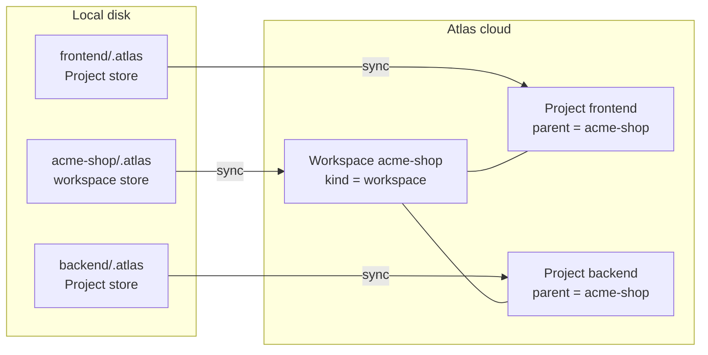

**Three rules carry the whole design:**

| # | Rule |
|---|---|
| 1 | A session is **stored once**, in the store of the folder where the agent started. That folder is its **home**. |
| 2 | A session is **tagged** with every Project whose files it changed. Tags are **derived** from rows the store already has. Nothing new is stored locally. |
| 3 | A **timeline is a filter**. The workspace timeline shows every session of the workspace and its Projects. A Project's timeline shows sessions whose home is that Project, plus sessions tagged with it. |

---

## 2. Background: how it works today (ADR-0015)

```
acme-shop/                    ← bound once, marker .atlas/workspace.json
├── .atlas/
│   ├── sessions.db           ← ONE store for every session
│   └── memory/               ← ONE memory
├── frontend/  (git)          ← member: hooks only, no .atlas
├── backend/   (git)          ← member: hooks only, no .atlas
└── infra/     (git)          ← member: hooks only, no .atlas
                    │
                    ▼
        ONE cloud Project, bound by name (no git fingerprint)
```

| # | Problem | Where it comes from | Impact |
|---|---|---|---|
| ① | A repository cloned in later has no hooks until `atlas workspace sync` is run | hooks are copied per member (`Targets`, `internal/project/workspace.go:156`) | 🔴 sessions silently not captured |
| ② | No shell changes and no commit links in workspace sessions | the recorder runs git in the mother folder, which is not a repository (`git.Link` returns early) | 🔴 a core feature is missing |
| ③ | The cloud matches a workspace by name only | a workspace has no git fingerprint | 🟠 fragile for teams and second machines |
| ④ | You can't see which repository a session worked on | one Project for everything | 🟠 noisy timeline |
| ⑤ | Opening a member in the desktop app creates a separate, empty store | the desktop doesn't read the marker | 🟡 confusing |
| ⑥ | Running `atlas init` inside a member quietly splits it off | the nearest binding wins | 🟡 surprising |

---

## 3. Goals and non-goals

### Goals

| ID | Goal |
|---|---|
| G1 | Every child repository of a workspace is a **real Project**, locally and in the cloud. |
| G2 | A session started in the parent shows in the **workspace timeline**. A session started in a child shows in **that Project's timeline** and the workspace timeline. |
| G3 | A session that **changes files in Project X** shows in X's timeline, wherever it started, with a tag saying why. |
| G4 | Git capture (shell changes and commit links) works in a workspace. |
| G5 | Repositories cloned in later are noticed, and the user is offered to add them. |
| G6 | The desktop's `sessions.db` schema v10 stays **unchanged, byte for byte**. |

### Non-goals (v1)

- Workspaces that span Organisations.
- Workspaces nested inside workspaces.
- Tags for read-only access ("viewed"). Only changes are tagged.
- Commit links for a member session's edits in a *sibling* repository. These are tagged but not linked (§7.6c).
- Tags in the desktop app (follow-up desktop work).
- A mother folder inside a git repository (a monorepo). That stays a plain Project, as in ADR-0015.
- Windows ([ADR-0006](adr/0006-windows-is-out-of-scope-for-v1.md)).

---

## 4. Terminology

| Term | Meaning | On disk / on the wire |
|---|---|---|
| **Workspace** | A folder of repositories bound once. It is a Project of kind `workspace`. | parent `.atlas/` with `workspace.json` `{"workspace": true}`; cloud Project `kind: "workspace"` |
| **Member Project** | A child folder bound as its own Project and linked to the workspace | child `.atlas/` with `workspace.json` `{"memberOf": ".."}`; cloud `parentId` |
| **Unbound member** | A child repository with no `.atlas/` yet (cloned later, or not added yet) | none |
| **Home** | The Project whose store recorded the session, i.e. where the agent started | the store that holds the `agent_session` row |
| **Tag** | A pair (Project, reason) on a session. The reason is `home`, `edited` or `committed`. | derived; sent as `projects[]` on the session artifact |
| **Timeline** | A filtered list of sessions in the cloud UI | cloud query (§7.8) |

> ⚠️ **Naming collision.** In schema v10 and the ingest wire, `workspace_id` / `workspaceId` mean a **Project** (locally the canonical path, in the cloud the Project id). This TRD does **not** rename them. The new "group" idea goes on the wire as `kind` and `parentId`, so the two meanings never meet in one field.

---

## 5. Scenarios

Layout used throughout: `acme-shop/` contains `frontend/`, `backend/` and `infra/`, all member Projects.

| # | Agent started in | Changes files in | Stored in | Tags | Shows in timelines |
|---|---|---|---|---|---|
| S1 | `acme-shop/` | nothing (just a chat) | workspace store | 🏠 acme-shop | Workspace |
| S2 | `acme-shop/` | frontend, backend | workspace store | 🏠 acme-shop · ✏️ frontend · ✏️ backend | Workspace, frontend, backend |
| S3 | `backend/` | backend | backend store | 🏠 backend | Workspace, backend |
| S4 | `backend/` | backend, frontend | backend store | 🏠 backend · ✏️ frontend | Workspace, backend, frontend |
| S5 | `acme-shop/` | backend, then a commit in backend | workspace store | 🏠 acme-shop · ✏️ backend · ⎇ backend | Workspace, backend (with the commit) |
| S6 | `acme-shop/` | `acme-shop/README.md` (the parent itself) | workspace store | 🏠 acme-shop | Workspace |
| S7 | `mobile/` (unbound) | mobile | workspace store | 🏠 acme-shop · ✏️ `mobile` (folder only, no Project yet) | Workspace; mobile once bound |

S2 drawn out:

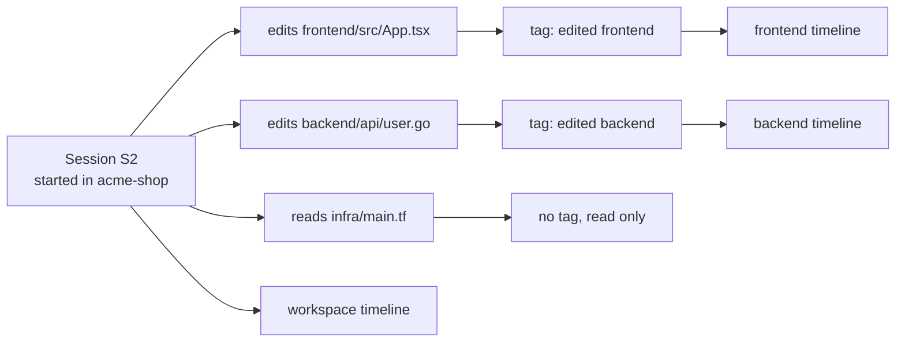

---

## 6. Design overview

### 6.1 Local layout

```
acme-shop/                          ← Workspace (not a git repo)
├── .atlas/
│   ├── sessions.db                 ← workspace store: sessions started HERE
│   ├── workspace.json              ← {"workspace": true, "folders": [...]}
│   └── memory/                     ← ONE shared memory (unchanged from ADR-0015)
├── frontend/                       ← git repo → member Project
│   └── .atlas/
│       ├── sessions.db             ← frontend store: sessions started HERE
│       └── workspace.json          ← {"memberOf": ".."}
├── backend/                        ← git repo → member Project
│   └── .atlas/ (same as frontend)
└── mobile/                         ← cloned later, no .atlas → unbound member
```

Every `sessions.db` is a normal schema-v10 store with one binding row. Nothing in the schema changes (G6).

### 6.2 Cloud model

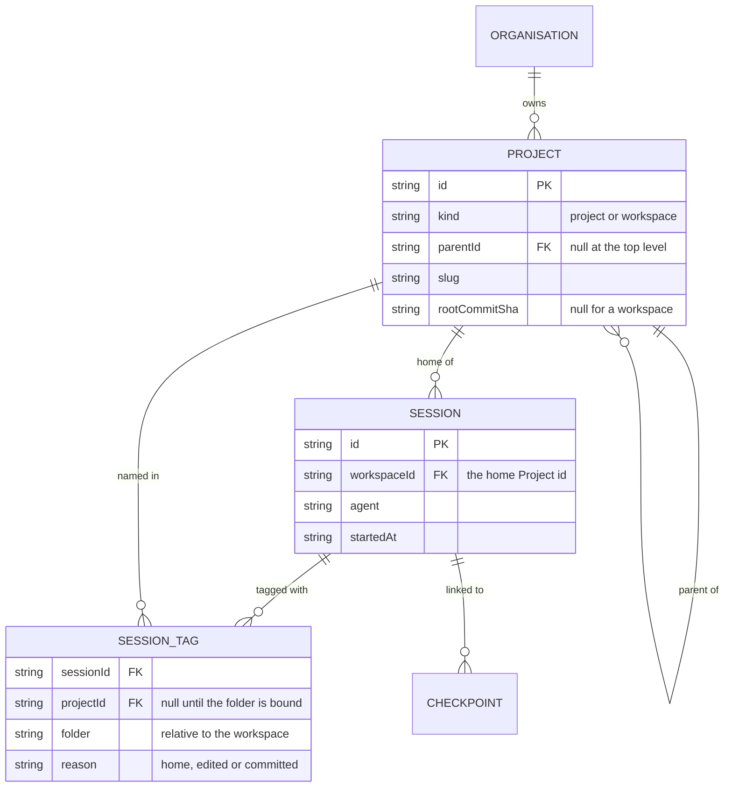

---

## 7. Detailed design

### 7.1 Markers

| File | Where | Content | Meaning |
|---|---|---|---|
| `.atlas/workspace.json` | parent | `{"workspace": true, "folders": ["docs"]}` | unchanged from ADR-0015 |
| `.atlas/workspace.json` | child | `{"memberOf": ".."}` | **new**: this Project belongs to the workspace one folder up |

- `memberOf` is a **relative** path, so moving the whole tree keeps working.
- It is honoured only when the folder it points to has `workspace: true` **and** a binding in the **same Organisation**. A stray marker never captures anything (the ADR-0015 safety rule).
- `folders` still lists members added by hand (non-git folders, or repositories deeper than one level). In the new model these become member Projects too. A non-git member binds by name, as a non-git Project does today.

### 7.2 Discovery: where does a session go?

The nearest binding already wins (`Discover`, `internal/project/project.go:97`). So once children have their own binding, routing comes almost for free. The only additions are reading `memberOf` and the unbound-member branch.

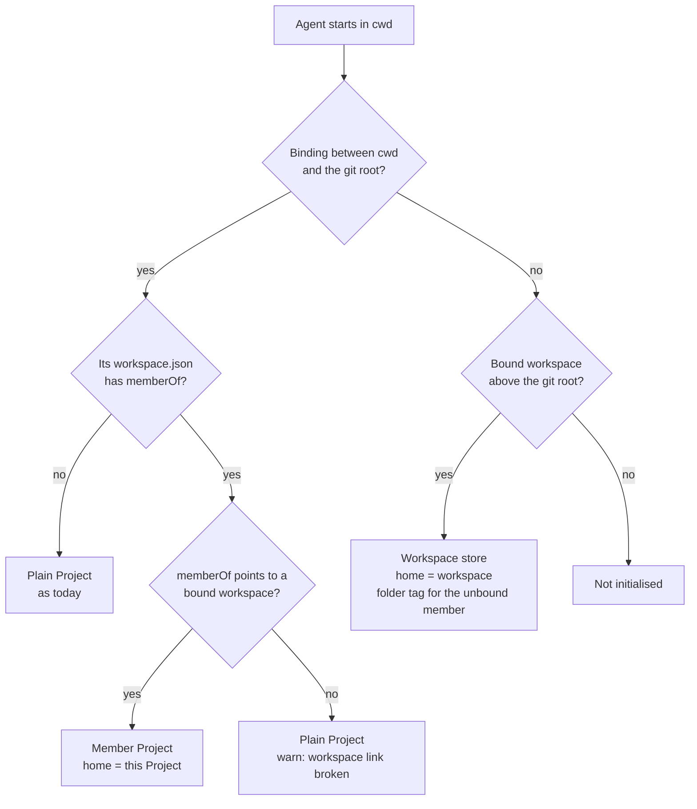

`project.Project` (`project.go:21`) gains `Kind` (`plain`, `workspace` or `member`) and `WorkspaceRoot` (empty unless it is a member).

### 7.3 Init flow

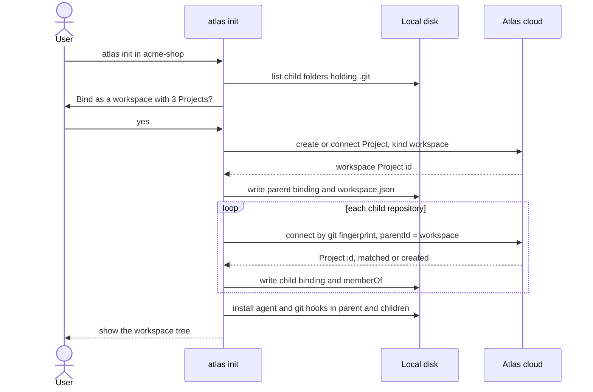

Edge cases:

| Case | Behaviour |
|---|---|
| A child is already a plain Project | Ask "Add backend to the workspace?" On yes, write `memberOf` and set `parentId` on its existing cloud Project. No data moves. |
| A child belongs to another workspace | Refuse and name the other workspace. |
| A child is in another Organisation | Refuse. Members share the workspace's Organisation. |
| `--local` | Same layout, no cloud calls. Tags are still derived locally and sent once the workspace is connected to the cloud. |
| No terminal (`--yes`, CI) | Bind the parent alone, print the child repositories and the command that adds them. Never pull repositories into the cloud implicitly (the ADR-0015 lesson). |

### 7.4 Tagging

#### Tag reasons

| Reason | Set when | Source rows (schema v10, unchanged) |
|---|---|---|
| `home` | always: the store that recorded the session | the store's `binding` row |
| `edited` | the session changed a file inside a member | `file_touch.path` |
| `committed` | a commit in a member was linked to the session | `checkpoint` rows |
| `viewed` | *later*: the session only read files | `tool_call.locations` |

#### Derivation: no schema change

`file_touch.path` is already project-relative, or absolute when `out_of_repo = 1` (`internal/capture/store/rows.go:419`). That is enough to map every touch to a member:

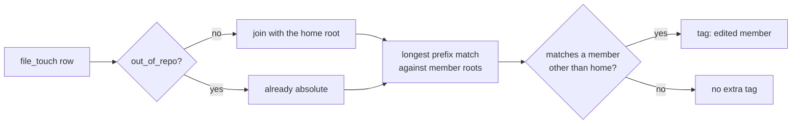

```go
// TagsOf derives a session's tags from rows the store already holds.
// Touches outside every member, such as the parent's own README, add no tag.
func TagsOf(home Project, ws Workspace, touches []store.FileTouch, cps []store.Checkpoint) []Tag {
	tags := newTagSet(Tag{Project: home, Reason: Home})
	for _, t := range touches {
		abs := t.Path
		if !t.OutOfRepo {
			abs = filepath.Join(home.Root, filepath.FromSlash(t.Path))
		}
		if m, ok := ws.MemberAt(abs); ok && m != home { // longest prefix wins
			tags.Add(Tag{Project: m, Reason: Edited})
		}
	}
	for _, c := range cps {
		tags.Add(Tag{Project: ws.RepoOf(c), Reason: Committed})
	}
	return tags.Sorted()
}
```

#### Tags grow during a session

Tags are only ever added. When a session touches a new member for the first time, the recorder updates the session row. The existing `resync` rule (`rows.go:129`) then flips the row from `sent` back to `pending`, so the session is sent again with its new tags.

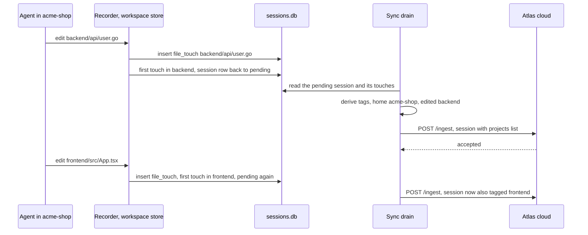

Tags are derived in the **drain**, not in the hook, so the hook path only gains one indexed insert (NFR-2).

### 7.5 Session routing summary

```
 agent started in ...           stored in            home         sent to cloud Project
 ────────────────────           ─────────            ────         ─────────────────────
 acme-shop/              ──▶    acme-shop store      acme-shop    acme-shop (workspace)
 acme-shop/backend/      ──▶    backend store        backend      backend
 acme-shop/backend/src/  ──▶    backend store        backend      backend
 acme-shop/mobile/       ──▶    acme-shop store      acme-shop    acme-shop (folder tag: mobile)
```

### 7.6 Git capture per member

Today the recorder's root is the mother folder. That folder is not a repository, so `gitStatus(root)` (`internal/capture/record/recorder.go:514`) and `git.Link` (`internal/capture/git/link.go:35`) do nothing. The fix has three parts.

**(a) Shell changes.** In a workspace store, `sampleShell` (`recorder.go:430`) runs `git status` in each member and prefixes the paths with the member folder. It samples only members under the shell's cwd, or all members when the cwd is the workspace root (see risk K4).

**(b) Commit links.** The post-commit hook in member M links M's commits against **two** stores:

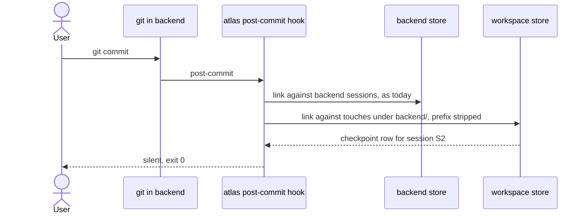

- `workspace_cursor` is keyed by a text id, so the workspace store keeps **one cursor per member**, keyed by the member's canonical path. No schema change.
- A new `LiveTouchesUnder(ctx, workspaceID, prefix)` sits beside `LiveTouches` (`internal/capture/store/checkpoint.go:53`).
- Checkpoint `files_touched` in the workspace store keep the `backend/…` prefix. That keeps the store's "paths are relative to this store's root" rule, and tells the tagger which repository the commit belongs to.

**(c) Sibling edits from a member session** (S4: a backend session edits frontend). These are tagged `edited frontend`, but **not** commit-linked in v1. They are `out_of_repo` rows, which by design never match a commit. Linking them later (FR-18) means frontend's post-commit would also scan its siblings' stores.

### 7.7 Sync and wire

Each store drains to **its own** cloud Project, as today (the target is the binding's `remote_workspace_id`). The session artifact (`internal/capture/sync/artifacts.go:25`) gains one **additive** field:

```json
{
  "type": "session",
  "workspaceId": "prj_acme_shop",
  "sessionId": "ses_01J…",
  "projects": [
    { "projectId": "prj_acme_shop", "folder": ".",        "reasons": ["home"] },
    { "projectId": "prj_backend",   "folder": "backend",  "reasons": ["edited", "committed"] },
    { "projectId": "prj_frontend",  "folder": "frontend", "reasons": ["edited"] },
    { "projectId": null,            "folder": "mobile",   "reasons": ["edited"] }
  ]
}
```

- `folder` is relative to the workspace. `projectId` is `null` while the folder is unbound. The CLI sends the session again once the folder is bound.
- The server treats `projects` as the **complete set** for the session, so a repeated send changes nothing (NFR-4).
- `atlas serve` today drains one store (`internal/capture/sync/runner.go:37`). Run in a workspace parent, it drains **the workspace store and every member store**. Hooks keep draining their own store after each delivery, as they do now.

### 7.8 Cloud (backend repository, proposed)

> **Superseded in detail by [workspace-server-changes.md](trd/workspace-server-changes.md).** The server stores sessions in one Durable Object per Workspace, so the SQL below is illustrative only. The server also calls the cloud entity a *Workspace*, and the artifact type is `agent_session`. See that doc's §12 for every correction.

| Change | Detail |
|---|---|
| `Project.kind` | `"project"` (default) or `"workspace"` |
| `Project.parentId` | a member Project's workspace; one level only |
| Create / Connect | accept `kind` and `parentId` (`internal/ingest/ingest.go`: `CreateRequest`, `ConnectRequest`). A child connects by git fingerprint, as a repository does today. |
| Ingest | accept `projects[]` on `session` artifacts and store them as `session_tag` rows |
| Timelines | the queries below |

```sql
-- Workspace timeline: every session homed in the workspace or one of its Projects
SELECT s.* FROM session s
WHERE s.workspace_id = :ws
   OR s.workspace_id IN (SELECT id FROM project WHERE parent_id = :ws)
ORDER BY s.last_activity_at DESC;

-- Project timeline: homed here, or tagged with this Project
SELECT s.* FROM session s
WHERE s.workspace_id = :p
   OR s.id IN (SELECT session_id FROM session_tag WHERE project_id = :p)
ORDER BY s.last_activity_at DESC;
```

### 7.9 Cloud UI (mock-ups)

**Workspace timeline**

```
┌ acme-shop · Workspace ──────────────────────────────────────────────┐
│ Filter: [All Projects ▾] [Agent ▾] [☐ Has commits]                  │
│                                                                     │
│ ● add user API + form       claude · 12m   🏠 acme-shop             │
│                                            ✏️ frontend  ✏️ backend   │
│                                            ⎇ backend a1b2c3         │
│ ● fix login button          codex  · 1h    🏠 frontend              │
│ ● terraform bump            claude · 3h    🏠 infra                 │
└─────────────────────────────────────────────────────────────────────┘
```

**Project timeline (backend)**

```
┌ backend · Project in acme-shop ─────────────────────────────────────┐
│ ● add user API + form       claude · 12m   from acme-shop ↗         │
│   only the backend part: 4 tool calls · 2 files · commit a1b2c3     │
│ ● migrate users table       claude · 2d    🏠 backend               │
└─────────────────────────────────────────────────────────────────────┘
```

The "only the backend part" view filters tool calls by their `locations` paths under `backend/` (FR-14).

### 7.10 Memory

**v1: one memory for the whole workspace**, in the workspace folder, as ADR-0015 §5 already does. The frontend agent still sees what the backend agent decided.

One change is required. With child bindings, `Discover` returns the child, and `MemoryRoot` (`internal/project/workspace.go:196`) would then return the child's own root, **splitting memory per Project**. `MemoryRoot` must follow `memberOf` to the workspace folder.

Later (FR-19): tag memory entries with a Project, using their evidence paths, and have `memory_search` rank the current Project's entries first.

### 7.11 Membership lifecycle

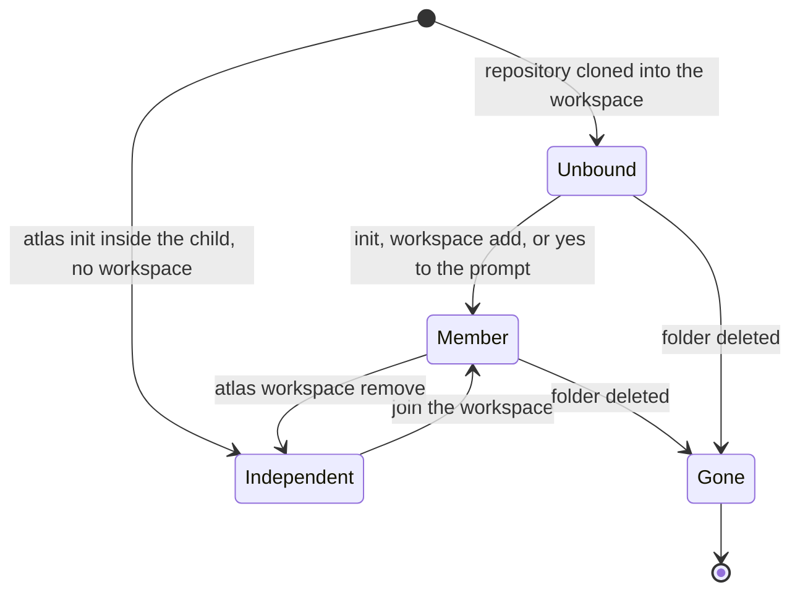

| State | Child `.atlas/` | Sessions started there go to | Tag in workspace sessions |
|---|---|---|---|
| **Unbound** | none | workspace store | folder only (`projectId: null`) |
| **Member** | binding + `memberOf` | its own store | `projectId` |
| **Independent** | binding, no `memberOf` | its own store, outside the workspace | none, because it is not part of the workspace |
| **Gone** | — | — | old tags are kept |

### 7.12 Self-healing membership (fixes ①)

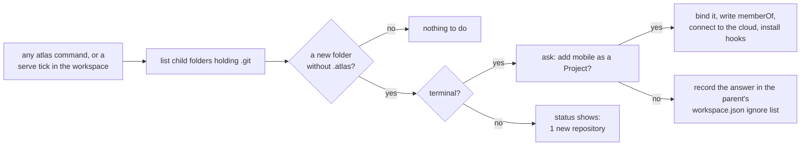

The CLI **never binds to the cloud or writes hooks into a repository without a yes**. One init in a folder of unrelated repositories once pulled ten of them into one cloud Project (ADR-0015).

### 7.13 CLI surface

| Today (ADR-0015) | Proposed |
|---|---|
| `atlas init --workspace`, or the init prompt | `atlas init` in a folder of repositories asks once: **"Workspace with N Projects"** or "This folder only" |
| `atlas workspace on` / `off` | kept. `off` turns members into Independent Projects and keeps their stores. |
| `atlas workspace sync` | folded into `atlas workspace`, which shows the tree and offers fixes |
| `atlas workspace add` / `remove <folder>` | kept. They now bind and unbind a member Project. |

```
$ atlas workspace
acme-shop · Workspace · cloud: acme/acme-shop
├── frontend   Project   claude ✓ codex ✓   12 sessions · 3 from the workspace
├── backend    Project   claude ✓ codex ✓   20 sessions · 5 from the workspace
├── infra      Project   claude ✓ codex ✓    4 sessions
└── mobile     new       not added           → atlas workspace add mobile
Memory: shared across the workspace · 148 entries
```

---

## 8. Requirements

### Functional

| ID | Requirement | Priority | Phase |
|---|---|---|---|
| FR-1 | `atlas init` in a folder of repositories offers a workspace with N Projects. It binds the parent (`kind: workspace`) and each child (member). | Must | P1 |
| FR-2 | The child marker `memberOf` is honoured only when it points to a bound workspace in the same Organisation | Must | P1 |
| FR-3 | Discovery: the nearest binding wins, and a member Project knows its workspace | Must | P1 |
| FR-4 | `MemoryRoot` follows `memberOf` to the workspace folder | Must | P1 |
| FR-5 | Hooks go into the parent, every member Project and every unbound member the user said yes to | Must | P1 |
| FR-6 | Tags (`home`, `edited`, `committed`) are derived from `file_touch` and `checkpoint` by longest-prefix match, with no schema change | Must | P2 |
| FR-7 | A session is sent again whenever its set of tags grows | Must | P2 |
| FR-8 | The session artifact carries `projects[]` | Must | P2 |
| FR-9 | The workspace recorder samples `git status` per member for shell changes | Must | P2 |
| FR-10 | Post-commit in a member links against both the member store and the workspace store | Must | P2 |
| FR-11 | `atlas serve` in the parent drains every store of the workspace | Should | P3 |
| FR-12 | Cloud: `kind` and `parentId`, and Create/Connect accept them | Must | P3 (backend) |
| FR-13 | Cloud timelines: the workspace shows everything; a Project shows home or tagged sessions | Must | P3 (backend) |
| FR-14 | Tag chips in the UI, and an "only the part that touched X" view | Should | P4 |
| FR-15 | Self-healing: detect new child repositories and offer to add them | Should | P4 |
| FR-16 | `atlas workspace` tree view | Should | P4 |
| FR-17 | Upgrade path for ADR-0015 workspaces, with tags for old sessions | Must | P5 |
| FR-18 | Commit links for sibling `out_of_repo` edits | Could | later |
| FR-19 | Memory entries tagged by Project, with search ranking the current Project first | Could | later |

### Non-functional

| ID | Requirement |
|---|---|
| NFR-1 | `sessions.db` stays the desktop's schema v10, byte for byte. Every store, parent or child, is a normal store. |
| NFR-2 | Tags are derived in the sync drain, never in the hook's hot path. A hook gains at most one indexed insert or update. |
| NFR-3 | Discovery costs no more than today's stat walk plus one small JSON read |
| NFR-4 | Sending the same tags again is a no-op on the server |
| NFR-5 | Local-only and offline work: tags are derived locally and sent when sync resumes |
| NFR-6 | Linux and macOS only (ADR-0006) |
| NFR-7 | Tests run in temporary folders or the Docker sandbox, **never against a real workspace binding**. A test that touched a real workspace once synced ten unrelated repositories into one cloud Project. |

---

## 9. Security and privacy

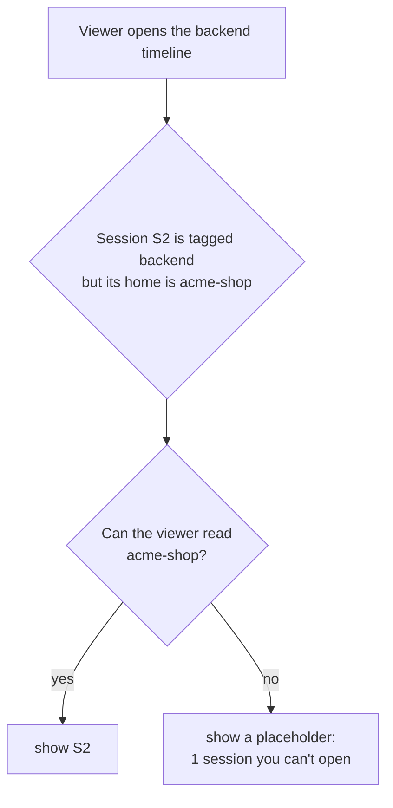

- **A tag never grants access.** Reading a session needs access to its **home** Project. Tags only decide where the session is listed.
- If the viewer can't read some member, the workspace timeline leaves out the sessions homed there.
- Tags carry folder names and Project ids only, never file contents. Redaction is unchanged and runs before rows are written.
- A workspace and its members share one Organisation. A `memberOf` link into another Organisation is refused.
- Binding repositories to the cloud is never implicit (§7.12).

---

## 10. Compatibility and migration

**Key insight:** an ADR-0015 workspace already *is* a new-model workspace in which every member is **unbound**. Its sessions sit in the parent store with paths such as `backend/src/x.go`, which is exactly what the tagger reads. Old workspaces keep working unchanged, and their old sessions get tags **retroactively, for free**.

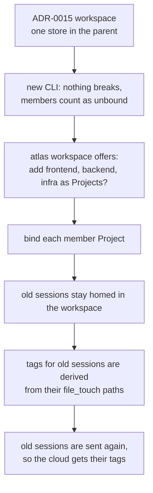

| Area | Effect |
|---|---|
| Desktop app | Opening a member now finds a real store with that member's sessions, which is better than today's empty store. It doesn't show parent-started sessions or tags (desktop follow-up). |
| Wire | One additive field. Whether today's ingest server ignores unknown fields is open (Q2). |
| Older CLI in a member | Sees a plain Project and ignores `memberOf`, so memory splits. The new marker sets a minimum CLI version, and `atlas update` fixes it. |

---

## 11. Rollout

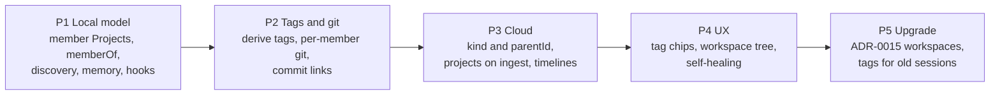

| Phase | Ships | Exit criteria | Depends on |
|---|---|---|---|
| P1 | FR-1 to FR-5 | S3 and S4 sessions land in the member store. Memory stays shared. Old workspaces behave as before. | — |
| P2 | FR-6 to FR-10 | S2 and S5 get correct tags locally, and S5 gets a commit link | P1 |
| P3 | FR-11 to FR-13 | The cloud shows the S1–S7 timelines as in §5 | P2 and the backend |
| P4 | FR-14 to FR-16 | A new clone is noticed and added after a yes | P3 |
| P5 | FR-17 | An ADR-0015 workspace upgrades and its old sessions show tags | P2 (local), P3 (cloud) |

P2 can ship before the backend is ready. Tags are derived locally and sent as soon as P3 lands.

---

## 12. Test plan

| Level | What |
|---|---|
| Unit | the longest-prefix resolver, including nested hand-added folders; `TagsOf` for S1–S7; `LiveTouchesUnder` prefix stripping; `MemoryRoot` for a member; `Discover` with a broken `memberOf` |
| Integration (temporary folders) | a workspace holding two real git repositories: run S2, commit in backend, check the checkpoint row in the workspace store and the tags in the encoded artifact |
| Sync | a fake ingest server checks that `projects[]` is sent, sent again when tags grow, and is idempotent |
| Acceptance | a new `docs/acceptance/workspace.md` covering S1–S7 in the cloud UI, an ADR-0015 upgrade, and a new clone being noticed |

Example acceptance case:

```gherkin
Given a workspace "acme-shop" with member Projects "frontend" and "backend"
When an agent started in "acme-shop" edits "backend/api/user.go"
And the user commits in "backend"
Then the session is stored in the acme-shop store
And it is tagged home acme-shop, edited backend, committed backend
And it appears in the acme-shop timeline and the backend timeline
And it does not appear in the frontend timeline
```

---

## 13. Risks and open questions

### Risks

| ID | Risk | Mitigation |
|---|---|---|
| K1 | One commit is linked to sessions in two stores (a workspace session and a member session both edited the file) | Acceptable, since both contributed. The cloud shows one commit with two sessions. |
| K2 | Prefix matching fails on path spelling: NFC/NFD, symlinks, case | Canonicalise member roots (`project.Canonical`) and reuse the NFC normalisation `file_touch` already applies |
| K3 | `memberOf` link breaks after a folder moves | The path is relative, so moving the whole tree works. A broken link falls back to a plain Project with a warning. |
| K4 | A workspace with 50 repositories makes per-member `git status` slow | Sample only members under the shell's cwd. Run in parallel, with the existing git timeout. |
| K5 | The server doesn't accept `projects[]` yet | Gate it on a server capability, and keep sending the old payload until then |

### Open questions

| ID | Question | Options | Recommendation |
|---|---|---|---|
| Q1 | Who maps paths to Projects? | the CLI (knows the layout) / the cloud (from `locations`) | **The CLI**, which sends `projects[]` |
| Q2 | Does today's ingest server ignore unknown fields? | — | Ask the backend team |
| Q3 | Add new repositories automatically? | always ask / a per-workspace setting | **Always ask** in v1 |
| Q4 | Memory: one per workspace, or per Project plus a shared layer? | — | **One per workspace** in v1 |
| Q5 | Restricted members in the workspace timeline | hide / show a placeholder | **Placeholder** |
| Q6 | Non-git folders added by hand: member Projects or workspace-level folders? | — | **Member Projects**, bound by name |
| Q7 | Nested workspaces? | — | **Refuse** in v1 |
| Q8 | Should the desktop show parent-started sessions inside a member? | — | Desktop follow-up. The desktop would need to read the parent store. |

---

## 14. Alternatives considered

| Alternative | Why not |
|---|---|
| **One store for the whole workspace** (today's model plus per-member git) | Members aren't real Projects. The desktop still opens an empty store for a member. The cloud can't match members by fingerprint. |
| **Copy a cross-Project session into each touched store** | Duplicate rows, tokens counted twice, conflicting updates, and three copies to redact and sync |
| **A new `session_tag` table in `sessions.db`** | Breaks the desktop's schema v10 (NFR-1). Deriving tags gives the same result with no table. |
| **Tags only in the cloud**, derived from `tool_call.locations` | The cloud would need to know the local folder layout. Local views get no tags. It breaks on `out_of_repo` absolute paths. (The cloud still uses `locations` for the "only the X part" view.) |

---

## 15. Code touchpoints

| Area | File | Change |
|---|---|---|
| Markers | `internal/project/workspace.go` (`marker`, `Members`, `Targets`) | add `memberOf`; members include bound members that point here |
| Discovery | `internal/project/project.go` (`Project`, `Discover`) | add `Kind` and `WorkspaceRoot` |
| Memory | `internal/project/workspace.go` (`MemoryRoot`) | follow `memberOf` |
| Init | `cmd/atlas-cli/project_cmds.go` (`runInit`, `bindFolder`) | bind children, connect with `parentId` |
| Workspace commands | `cmd/atlas-cli/workspace_cmds.go` | tree view; `add`/`remove` bind and unbind members |
| Tags | new `internal/project/tags.go` | `TagsOf` and the prefix resolver |
| Recorder | `internal/capture/record/recorder.go` (`sampleShell`, `gitStatus`) | `git status` per member |
| Store | `internal/capture/store/checkpoint.go` (`LiveTouches`) | add `LiveTouchesUnder` |
| Commit links | `internal/capture/git/link.go` (`Link`) | also link into the workspace store, with the prefix |
| Sync | `internal/capture/sync/artifacts.go` (`sessionArtifact`) | add `projects[]` |
| Ingest | `internal/ingest/ingest.go` (`CreateRequest`, `ConnectRequest`, `Workspace`) | add `kind` and `parentId` |
| Serve | `cmd/atlas-cli/serve_cmds.go` (`runServe`) | drain every store in a workspace |
| Decision record | `docs/adr/0016-…` | new ADR amending ADR-0015 |
